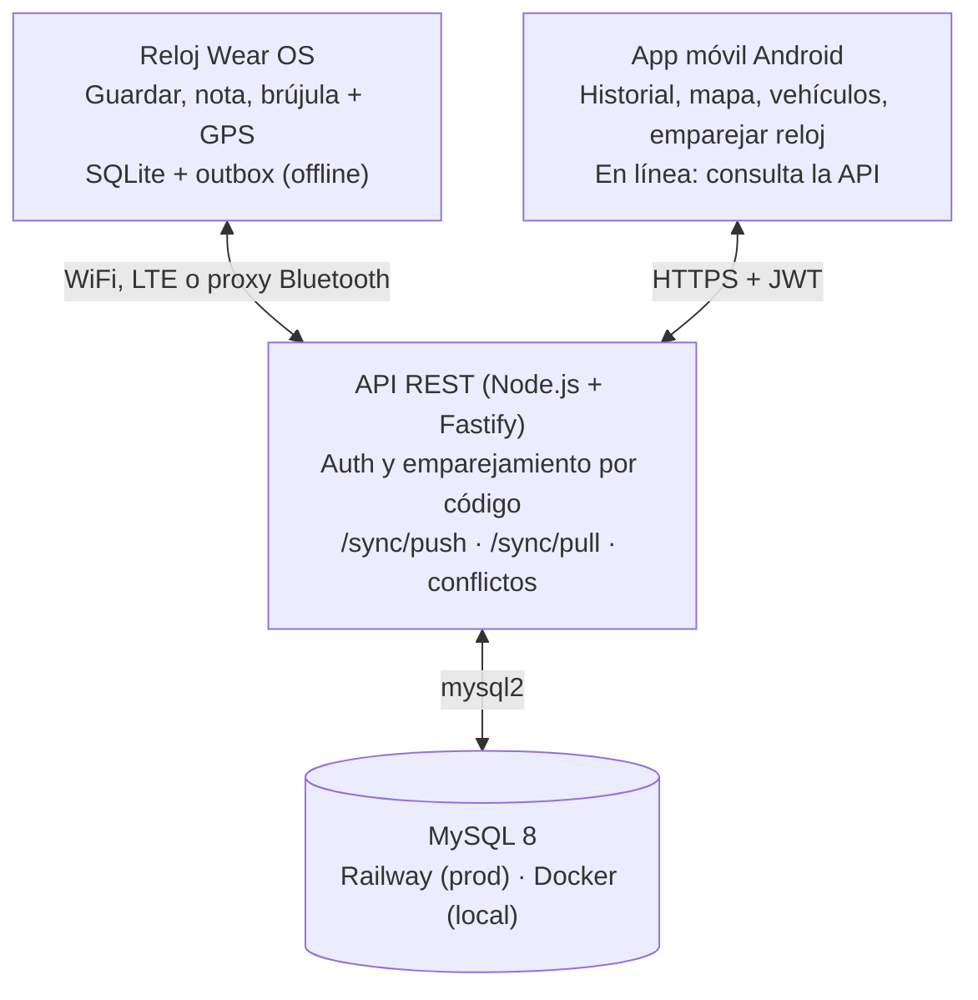

# Where I Parked It — Arquitectura y flujo de trabajo

Actualizado: 23 de octubre de 2026 · Isabel

El proyecto queda listo el lunes 26 de octubre de 2026 a las 15:00 para entregarse el martes 27. Son tres proyectos independientes en un repo: una API Node.js con MySQL, una app móvil Android con Expo y una app de reloj Wear OS con Expo. Solo el reloj guarda en SQLite local, para funcionar sin teléfono ni internet. `main` queda protegida con un ruleset que solo Isabel puede saltar al hacer merge. El esqueleto de las tres apps ya está en la carpeta del repo, y la API está probada contra MySQL 8.

## Advertencias antes de empezar

- **Hay 3 días, no 4 semanas.** El alcance de abajo es lo máximo que cabe. Todo lo que no está en "Imprescindible" espera a que eso funcione de punta a punta.

- **El reloj se decide el sábado a las 12:00.** Si para entonces la app no corre en el emulador Wear OS con GPS y SQLite, Jeshua pasa al plan B (Kotlin + Compose for Wear OS, solo 3 pantallas). React Native en Wear OS funciona porque el reloj es un Android, pero Expo no lo soporta oficialmente: se usa *development build* (no Expo Go) y la UI debe caber en una pantalla redonda.

- **Solo Android: Wear OS en el reloj y Android en el teléfono.** El proyecto no contempla iOS ni Apple Watch (watchOS no ejecuta React Native). Kassie y Jeshua usan iPhone, así que las pruebas que cuentan se hacen en emuladores Android (sección 6).

- **El mapa del APK necesita una clave de Google Maps.** En Expo Go el mapa funciona sin clave, pero en el APK sale en blanco. Isabel debe crear la clave (Google Cloud, API *Maps SDK for Android*) el sábado, no el lunes.

- **La cola gratuita de EAS Build puede tardar horas.** Los APK se lanzan el lunes temprano y hay un respaldo local (`npx expo run:android --variant release`).

- **El repo debe seguir público.** Los rulesets son gratis en repos públicos; en privado requieren GitHub Pro o Team.

- **Supongo que** `Terreneitor370` **es la cuenta de Isabel.** El ruleset da el permiso de merge a quien administre el repo.

- **El GPS no necesita internet; los mapas sí.** En el reloj, la navegación offline es flecha de brújula + distancia, no un mapa.

## Alcance para la entrega

| Imprescindible                                                                                         | Deseable                                         | Fuera de esta entrega                         |
|--------------------------------------------------------------------------------------------------------|--------------------------------------------------|-----------------------------------------------|
| Reloj: guardar ubicación con nivel, flecha de brújula con distancia, "Ya lo recogí", todo sin conexión | API desplegada en Railway                        | Refresh tokens y revocar dispositivos         |
| Reloj: emparejar por código de 6 dígitos                                                               | Editar vehículos y filtrar historial en el móvil | App móvil sin conexión (offline-first)        |
| Móvil: registro y login, vehículos, estacionamiento actual en mapa, historial, "Ya lo recogí"          | Iconos y diseño final                            | Notas escritas desde el reloj                 |
| API: auth, vehículos, estacionamientos, notas, emparejamiento, `/sync/push` y `/sync/pull`             | Nota rápida desde el móvil                       | Geocodificación (dirección en texto)          |
| Sincronización: lo guardado en el reloj sin red aparece en el móvil al volver la conexión              |                                                  | iOS, Apple Watch, pruebas automatizadas de UI |

Todo lo imprescindible ya tiene código base en el esqueleto; el trabajo del fin de semana es probarlo en los emuladores, corregirlo y pulir las pantallas.

## 1. Arquitectura del sistema

El reloj escribe primero en su SQLite local y sincroniza con la API cuando hay red; la app móvil consulta la API en línea. Solo la API toca MySQL. El reloj nunca depende del teléfono: habla directo con la API por WiFi, LTE o el proxy Bluetooth del teléfono que Wear OS activa solo.



arquitectura · reloj y app móvil, API, MySQL

Las flechas dobles son peticiones de ida y vuelta; el reloj y el teléfono no se hablan directo, se ponen de acuerdo a través de la API.

### Componentes

| Componente          | Responsabilidad                                                                                  | Almacenamiento local                            |
|---------------------|--------------------------------------------------------------------------------------------------|-------------------------------------------------|
| App reloj (Wear OS) | Guardar ubicación con nivel, flecha de brújula + distancia, "Ya lo recogí", emparejar por código | SQLite (expo-sqlite) + outbox                   |
| App móvil (Android) | Login, vehículos, estacionamiento actual en mapa, historial, confirmar el código del reloj       | Ninguno: consulta la API (solo guarda el token) |
| API REST            | Autenticación, validación, emparejamiento, sincronización y resolución de conflictos             | MySQL 8                                         |

### Estrategia offline-first (en el reloj)

1.  **Todo se guarda local primero.** "Guardar aquí" lee el GPS, inserta la fila en SQLite y vuelve al inicio, haya o no señal.

2.  **Bandeja de salida (outbox).** Cada cambio también se anota en la tabla `outbox` (`entity`, `record_id`, `payload`, `attempts`), en orden. Se vacía al abrir la app, al guardar, cada 60 s y cuando vuelve la red (`@react-native-community/netinfo`).

3.  **IDs generados en el dispositivo.** Cada registro nace con un UUID (`expo-crypto`), así no hay choques ni hay que esperar al servidor.

4.  **Borrado lógico.** Nada se borra físicamente: se marca `deleted_at`, para que el borrado también se sincronice.

5.  **Brújula offline.** El reloj calcula distancia (Haversine) y rumbo entre su GPS y el coche, y gira la flecha con `Location.watchHeadingAsync`.

### Protocolo de sincronización

- **Push:** `POST /sync/push` con `{ changes: [{ entity, data }] }`, cada cambio con el registro completo. La API responde `accepted` (aplicados o ignorados por ser más viejos: salen del outbox) y `rejected` (errores: se reintentan hasta 5 veces).

- **Pull:** `GET /sync/pull?since=<cursor>` devuelve los vehículos, estacionamientos y notas con `server_updated_at >= since`, y un cursor nuevo. Es inclusivo a propósito: un registro repetido no hace daño.

- **Orden:** siempre push y luego pull.

- **Conflictos:** gana el registro con `updated_at` más reciente, con la misma regla en MySQL y en SQLite.

- **Un solo estacionamiento activo por vehículo:** al guardar uno nuevo, desde el reloj o el teléfono, se cierran los activos anteriores del mismo vehículo.

### Autenticación

- **Móvil:** correo y contraseña (hash con bcrypt). La API entrega un JWT de 30 días que se guarda en `expo-secure-store`. No hay refresh tokens en esta entrega.

- **Reloj, por código:**

  1.  El reloj pide un código: `POST /pair/code`.

  2.  Lo muestra en pantalla (6 dígitos, vence en 10 minutos).

  3.  El usuario lo escribe en el móvil, en *Ajustes › Emparejar reloj*: `POST /pair/confirm`.

  4.  El reloj consulta cada 3 s `GET /pair/status/:code` y recibe su propio JWT de 30 días.

- Los códigos viven en memoria: si la API se reinicia, el reloj solo pide uno nuevo. "Desemparejar" en el reloj borra el token y los datos locales.

## 2. Stack tecnológico

TypeScript en las tres apps y SQL directo en lugar de un ORM: menos piezas que configurar en tres días. Las versiones son las del esqueleto.

| Capa                       | Herramienta                                                                          | Por qué                                                                                  |
|----------------------------|--------------------------------------------------------------------------------------|------------------------------------------------------------------------------------------|
| Lenguaje                   | TypeScript estricto                                                                  | Errores de tipos antes de correr; el CI los revisa en cada PR                            |
| App móvil                  | Expo SDK 58 + Expo Router                                                            | Android; se prueba con Expo Go y se compila a APK con EAS                                |
| Reloj                      | Expo SDK 58 con *development build* + plugin `withWearOS`                            | El plugin declara `android.hardware.type.watch` y la app como independiente del teléfono |
| Plan B reloj               | Kotlin + Compose for Wear OS                                                         | Solo si el sábado a las 12:00 React Native no corre en el reloj                          |
| Datos del servidor (móvil) | TanStack Query                                                                       | Caché, reintentos y recarga cada 15 s para ver lo que guarda el reloj                    |
| Base local (reloj)         | expo-sqlite con SQL directo                                                          | Persistencia offline sin configurar un ORM                                               |
| Red (reloj)                | @react-native-community/netinfo                                                      | Sincronizar cuando vuelve la conexión                                                    |
| GPS y brújula              | expo-location (`getCurrentPositionAsync`, `watchPositionAsync`, `watchHeadingAsync`) | Ubicación y rumbo sin internet                                                           |
| Mapa (móvil)               | react-native-maps                                                                    | Google Maps en Android; el APK necesita `GOOGLE_MAPS_API_KEY`                            |
| Tokens                     | expo-secure-store                                                                    | Guarda el JWT cifrado en el dispositivo                                                  |
| API                        | Node.js 22 LTS + Fastify 5                                                           | Rápido de escribir y con buen manejo de errores                                          |
| Validación                 | Zod 4                                                                                | Responde 400 con el campo exacto que falló                                               |
| Acceso a datos             | mysql2 + `apps/api/db/schema.sql`                                                    | Sin migraciones: el esquema se aplica con Docker o `npm run db:init`                     |
| Base de datos              | MySQL 8.4 (mínimo 8.0.19)                                                            | Requisito del proyecto; el upsert de sync usa `INSERT ... AS new`                        |
| Auth                       | JWT de 30 días (@fastify/jwt) + bcryptjs                                             | Sin dependencias nativas que compilar en Windows                                         |
| BD de desarrollo           | Docker Compose con MySQL 8.4                                                         | `docker compose up -d` aplica el esquema la primera vez                                  |
| CI                         | GitHub Actions, job `ci`                                                             | `npm ci` + `npm run typecheck` en las tres apps                                          |
| Despliegue API             | Railway (API + MySQL)                                                                | Para integrar el fin de semana; la demo también corre local                              |
| APKs                       | EAS Build, perfil `preview`                                                          | APK instalable sin tiendas; respaldo con build local                                     |

## 3. Base de datos (MySQL 8)

Cuatro tablas: el núcleo es `parking_sessions` (un estacionamiento = una ubicación con fecha de llegada y de salida), con sus notas aparte para permitir varias por sesión. Las tablas que se sincronizan comparten tres columnas: `updated_at` (hora del cliente, decide conflictos), `server_updated_at` (hora del servidor, cursor del pull) y `deleted_at` (borrado lógico). Para esta entrega se quitaron `devices` y `refresh_tokens`: el origen de cada estacionamiento queda en `source`.

| Tabla              | Qué guarda                                                                                         | Relaciones                               |
|--------------------|----------------------------------------------------------------------------------------------------|------------------------------------------|
| `users`            | Cuenta: correo, hash de contraseña, nombre                                                         | 1 → N vehículos, estacionamientos, notas |
| `vehicles`         | Alias, placa, marca, modelo, color, predeterminado                                                 | N → 1 usuario; 1 → N estacionamientos    |
| `parking_sessions` | Coordenadas, precisión, nivel, zona, cajón, origen (`watch` o `phone`), fechas de llegada y salida | N → 1 vehículo y usuario                 |
| `parking_notes`    | Texto libre ("junto al elevador")                                                                  | N → 1 estacionamiento                    |

``` sql
CREATE TABLE IF NOT EXISTS users (
  id                CHAR(36)     PRIMARY KEY,
  email             VARCHAR(255) NOT NULL UNIQUE,
  password_hash     VARCHAR(255) NOT NULL,
  display_name      VARCHAR(100) NOT NULL,
  created_at        DATETIME(3)  NOT NULL DEFAULT CURRENT_TIMESTAMP(3),
  updated_at        DATETIME(3)  NOT NULL DEFAULT CURRENT_TIMESTAMP(3) ON UPDATE CURRENT_TIMESTAMP(3)
);

CREATE TABLE IF NOT EXISTS vehicles (
  id                CHAR(36)     PRIMARY KEY,
  user_id           CHAR(36)     NOT NULL,
  nickname          VARCHAR(50)  NOT NULL,
  plate             VARCHAR(15)  NULL,
  brand             VARCHAR(50)  NULL,
  model             VARCHAR(50)  NULL,
  color             VARCHAR(30)  NULL,
  is_default        BOOLEAN      NOT NULL DEFAULT FALSE,
  created_at        DATETIME(3)  NOT NULL,
  updated_at        DATETIME(3)  NOT NULL,
  server_updated_at DATETIME(3)  NOT NULL DEFAULT CURRENT_TIMESTAMP(3) ON UPDATE CURRENT_TIMESTAMP(3),
  deleted_at        DATETIME(3)  NULL,
  CONSTRAINT fk_vehicles_user FOREIGN KEY (user_id) REFERENCES users(id) ON DELETE CASCADE,
  INDEX idx_vehicles_sync (user_id, server_updated_at)
);

CREATE TABLE IF NOT EXISTS parking_sessions (
  id                CHAR(36)      PRIMARY KEY,
  user_id           CHAR(36)      NOT NULL,
  vehicle_id        CHAR(36)      NOT NULL,
  source            ENUM('watch','phone') NOT NULL,
  latitude          DECIMAL(10,7) NOT NULL,
  longitude         DECIMAL(10,7) NOT NULL,
  accuracy_m        DECIMAL(6,1)  NULL,
  level             VARCHAR(20)   NULL,
  zone              VARCHAR(30)   NULL,
  spot              VARCHAR(20)   NULL,
  parked_at         DATETIME(3)   NOT NULL,
  ended_at          DATETIME(3)   NULL,
  created_at        DATETIME(3)   NOT NULL,
  updated_at        DATETIME(3)   NOT NULL,
  server_updated_at DATETIME(3)   NOT NULL DEFAULT CURRENT_TIMESTAMP(3) ON UPDATE CURRENT_TIMESTAMP(3),
  deleted_at        DATETIME(3)   NULL,
  CONSTRAINT fk_sessions_user    FOREIGN KEY (user_id)    REFERENCES users(id)    ON DELETE CASCADE,
  CONSTRAINT fk_sessions_vehicle FOREIGN KEY (vehicle_id) REFERENCES vehicles(id),
  INDEX idx_sessions_active  (vehicle_id, ended_at),
  INDEX idx_sessions_history (user_id, parked_at),
  INDEX idx_sessions_sync    (user_id, server_updated_at)
);

CREATE TABLE IF NOT EXISTS parking_notes (
  id                CHAR(36)     PRIMARY KEY,
  session_id        CHAR(36)     NOT NULL,
  user_id           CHAR(36)     NOT NULL,
  body              VARCHAR(500) NOT NULL,
  created_at        DATETIME(3)  NOT NULL,
  updated_at        DATETIME(3)  NOT NULL,
  server_updated_at DATETIME(3)  NOT NULL DEFAULT CURRENT_TIMESTAMP(3) ON UPDATE CURRENT_TIMESTAMP(3),
  deleted_at        DATETIME(3)  NULL,
  CONSTRAINT fk_notes_session FOREIGN KEY (session_id) REFERENCES parking_sessions(id) ON DELETE CASCADE,
  CONSTRAINT fk_notes_user    FOREIGN KEY (user_id)    REFERENCES users(id)            ON DELETE CASCADE,
  INDEX idx_notes_sync (user_id, server_updated_at)
);
```

El archivo real es `apps/api/db/schema.sql`. En el reloj, SQLite replica `vehicles`, `parking_sessions` y `parking_notes` con las columnas que necesita, más `outbox` (cambios pendientes de subir) y `sync_state` (cursor y última sincronización); su esquema está en `apps/watch/src/db.ts`.

## 4. Estructura del repositorio

Un repo con tres proyectos npm independientes, sin pnpm workspaces ni Turborepo. Expo dentro de un monorepo suele requerir ajustes de Metro que pueden costar medio día; así, cada app se instala y se corre dentro de su carpeta. El contrato entre apps es la API (tabla en el `README.md`), y el cálculo de distancia y rumbo vive solo en el reloj.

``` text
where-i-parked-it/
├── apps/
│   ├── api/                          # Fastify + mysql2 (MySQL)
│   │   ├── db/schema.sql             # esquema completo de MySQL
│   │   ├── src/
│   │   │   ├── routes/               # health, auth, vehicles, parking, pair, sync
│   │   │   ├── scripts/db-init.ts    # aplica schema.sql (npm run db:init)
│   │   │   ├── auth.ts               # JWT y guardia de rutas
│   │   │   ├── db.ts                 # pool de mysql2 (UTC)
│   │   │   ├── env.ts                # variables de entorno validadas
│   │   │   ├── mappers.ts            # filas MySQL -> JSON
│   │   │   └── server.ts
│   │   └── .env.example
│   ├── mobile/                       # Expo: solo Android (Expo Go en desarrollo)
│   │   ├── src/app/                  # rutas de Expo Router
│   │   │   ├── _layout.tsx           # sesión + rutas protegidas
│   │   │   ├── login.tsx
│   │   │   └── (tabs)/               # index (Mi coche), historial, vehiculos, ajustes
│   │   ├── src/lib/                  # api, session, ui, format, config
│   │   ├── app.json + app.config.ts  # clave de Google Maps por variable de entorno
│   │   ├── eas.json                  # perfil preview = APK
│   │   └── .env.example
│   └── watch/                        # Expo development build para Wear OS
│       ├── App.tsx                   # navegación por estado y sincronización periódica
│       ├── src/screens/              # Pair, Home, Save, Find
│       ├── src/                      # db (SQLite + outbox), sync, geo, api, ui, config
│       ├── plugins/withWearOS.js     # config plugin: manifest de Wear OS
│       ├── eas.json
│       └── .env.example
├── docs/
│   ├── architecture.md               # este documento
│   └── Arquitectura-y-flujo-de-trabajo-Where-I-Parked-It.docx
├── .github/
│   ├── workflows/ci.yml              # typecheck de las tres apps en cada PR
│   ├── ISSUE_TEMPLATE/tarea.md
│   ├── CODEOWNERS
│   └── pull_request_template.md
├── docker-compose.yml                # MySQL 8.4 local
├── .gitignore, .gitattributes, .editorconfig, .nvmrc
├── CONTRIBUTING.md                   # cómo trabajamos (secciones 5 y 6 resumidas)
└── README.md                         # arranque rápido, flujo de demo y tabla de la API
```

Regla: ninguna app importa código de otra; si dos apps necesitan lo mismo, se copia.

## 5. Flujo de trabajo con Git y GitHub

GitHub Flow adaptado: `main` siempre funciona, todo el trabajo ocurre en ramas cortas que entran a `main` por Pull Request con squash, y solo Isabel puede hacer ese merge. Gitflow (con `develop`, `release`, `hotfix`) sobra para 3 personas y una sola entrega, que se marca con el tag `v1.0.0`.

### 5.1 Ramas y convenciones

| Tipo          | Formato de rama              | Ejemplo                  |
|---------------|------------------------------|--------------------------|
| Funcionalidad | `feat/<issue>-<descripcion>` | `feat/12-brujula-reloj`  |
| Corrección    | `fix/<issue>-<descripcion>`  | `fix/18-mapa-en-blanco`  |
| Documentación | `docs/<descripcion>`         | `docs/readme`            |
| Mantenimiento | `chore/<descripcion>`        | `chore/actualizar-expo`  |
| Entrega       | tag `vX.Y.Z` sobre `main`    | `v1.0.0` = entrega final |

- **Una rama = un issue = un PR pequeño.** Con 3 días, un PR no debe vivir más de unas horas.

- **Commits con Conventional Commits:** `feat(watch): flecha de brújula hacia el coche`, `fix(api): validar latitud`. Alcances: `api`, `mobile`, `watch`, `docs`, `ci`. No hay herramienta que lo obligue; lo revisa Isabel en el título del PR.

- **Sin trailers de coautoría** (`Co-Authored-By`) de herramientas de IA en commits ni PRs.

- **Squash merge:** cada PR queda como un solo commit en `main`, con el título del PR como mensaje.

### 5.2 Proteger `main` (lo hace Isabel una sola vez)

El repo es personal, así que Kassie y Jeshua entran como colaboradores con permiso de escritura (GitHub no ofrece "solo lectura" en repos personales). El bloqueo lo hace un ruleset con la regla **Restrict updates**: nadie puede modificar `main`, ni con push ni con merge, salvo quien esté en la lista de bypass, que serás solo tú como administradora.

1.  **Haz el primer commit antes del ruleset.** El repo está vacío: sube el esqueleto de tu carpeta (sección 4) directo a `main`. Después del ruleset ya no podrás hacer push directo.

2.  **Agrega al equipo.** *Settings → Collaborators → Add people* → Kassie y Jeshua. Cada quien acepta la invitación desde su correo.

3.  **Ajusta los merges.** *Settings → General → Pull Requests*: deja activado solo **Allow squash merging**, y activa **Always suggest updating pull request branches** y **Automatically delete head branches**.

4.  **Crea el ruleset.** *Settings → Rules → Rulesets → New ruleset → New branch ruleset*:

    - Name: `proteger-main` · Enforcement status: **Active**

    - Bypass list → *Add bypass* → **Repository admin** → cambia el modo a **For pull requests only** (ni tú podrás hacer push directo; tú también trabajas con PR)

    - Target branches → *Add target* → **Include default branch**

    - Activa: **Restrict updates**, **Restrict deletions**, **Require linear history**, **Block force pushes**

    - Activa **Require a pull request before merging** con: 1 aprobación requerida, *Dismiss stale pull request approvals when new commits are pushed*, *Require review from Code Owners*, *Require approval of the most recent reviewable push*, *Require conversation resolution before merging*, y en *Allowed merge methods* solo **Squash**

    - Guarda con **Create**

5.  **Define a la dueña del código.** El esqueleto ya trae `.github/CODEOWNERS` con la línea `* @Terreneitor370`. Así GitHub te asigna como revisora de todos los PRs y solo tu aprobación cuenta.

6.  **Agrega el check de CI** en cuanto `.github/workflows/ci.yml` haya corrido una vez tras el primer push (ya viene en el esqueleto): edita el ruleset, activa **Require status checks to pass** y agrega el job `ci`.

7.  **Pruébalo.** Pide a Kassie que haga `git push origin main` con un commit de prueba: debe rechazarse con `GH013: Repository rule violations`.

| Acción                                   | Kassie y Jeshua                | Isabel               |
|------------------------------------------|--------------------------------|----------------------|
| Crear ramas y hacer push a ellas         | Sí                             | Sí                   |
| Abrir PRs hacia `main`                   | Sí                             | Sí                   |
| Aprobar PRs (aprobación que cuenta)      | No (pueden comentar y revisar) | Sí, como Code Owner  |
| Hacer merge a `main`                     | No                             | Sí, usando el bypass |
| Push directo, force push o borrar `main` | No                             | No                   |

Al hacer merge verás la casilla *Merge without waiting for requirements to be met (bypass rules)*. Es normal: úsala solo cuando el CI esté en verde y hayas aprobado. Tus propios PRs no los puedes aprobar tú; pídele a Kassie o Jeshua una revisión antes de hacer merge, aunque GitHub no la exija.

### 5.3 Guía rápida de comandos

**Configuración inicial (cada integrante, una vez):**

``` bash
git clone https://github.com/Terreneitor370/where-i-parked-it.git
cd where-i-parked-it
git config user.name "Tu Nombre"
git config user.email "tu-correo-de-github@ejemplo.com"

# Cada app se instala en su carpeta (Windows: copy en lugar de cp)
cd apps/api    && npm install && cp .env.example .env && cd ../..
cd apps/mobile && npm install && cp .env.example .env && cd ../..
cd apps/watch  && npm install && cp .env.example .env && cd ../..

docker compose up -d       # MySQL local con el esquema aplicado
```

**Ciclo de trabajo (Kassie, Jeshua e Isabel):**

``` bash
# 1. Parte de main actualizado
git switch main
git pull --ff-only

# 2. Crea tu rama desde el issue
git switch -c feat/12-guardar-ubicacion-reloj

# 3. Trabaja y haz commits pequeños
git add -p
git commit -m "feat(watch): guardar ubicación con un toque"

# 4. Antes de subir, ponte al día con main
git fetch origin
git rebase origin/main

# 5. Sube la rama y abre el PR
git push -u origin feat/12-guardar-ubicacion-reloj
gh pr create --base main --fill      # o desde la web de GitHub

# 6. Si piden cambios: commit + push a la misma rama
git commit -m "fix(watch): manejar GPS sin señal"
git push
#    (si hiciste rebase después de subir)
git push --force-with-lease

# 7. Después del merge, limpia
git switch main
git pull --ff-only
git branch -d feat/12-guardar-ubicacion-reloj
```

**Si hay conflictos en el rebase:**

``` bash
# edita los archivos marcados con <<<<<<< y >>>>>>>
git add <archivo>
git rebase --continue
# para cancelar y volver a como estabas:
git rebase --abort
```

**Solo Isabel — revisar, hacer merge y marcar entregas:**

``` bash
gh pr list                                  # PRs abiertos
gh pr checkout 15                           # prueba el PR localmente
cd apps/<app que cambió> && npm run typecheck
gh pr review 15 --approve                   # o --request-changes -b "motivo"
gh pr merge 15 --squash --delete-branch --admin   # --admin usa el bypass

# Entrega final
git switch main && git pull --ff-only
git tag -a v1.0.0 -m "Entrega final"
git push origin v1.0.0
```

**Plantilla de PR** (`.github/pull_request_template.md`): qué cambia, issue que cierra (`Closes #12`), cómo probarlo, capturas si toca UI, y la casilla "probé en emulador o dispositivo".

## 6. Desarrollo con emuladores (Expo y Android Studio)

Todo el desarrollo y la demo corren en emuladores de Android Studio: la app móvil se abre con Expo Go en un emulador de teléfono Android, y la app del reloj se compila con Expo hacia un emulador Wear OS. Como el reloj habla directo con la API, no hace falta emparejar los emuladores entre sí; cada uno tiene internet propio a través de la computadora.

### Advertencias

- **Expo Go para el móvil, development build para el reloj.** La app móvil corre en Expo Go sin compilar y con recarga instantánea. Expo Go no existe para Wear OS, así que el reloj se compila con `npx expo run:android` hacia su emulador.

- **Límite de Expo Go.** Solo incluye los módulos nativos del SDK de Expo; los que usa el móvil (expo-location, expo-secure-store, react-native-maps) sí vienen. Si agregan una librería nativa fuera de esa lista, el móvil también pasa a development build. La versión de Expo Go instalada debe coincidir con el SDK del proyecto.

- **iPhone solo como vista previa.** Kassie y Jeshua pueden abrir la app móvil en Expo Go en su iPhone para revisar diseño, pero ahí corre como iOS: mapas, permisos y GPS se comportan distinto. Ninguna funcionalidad se da por terminada sin probarla en el emulador Android. Desde el iPhone, la API local se alcanza con la IP de la computadora en la misma WiFi (`http://192.168.x.x:3000`), no con `localhost`.

<!-- -->

- **Memoria RAM.** Dos emuladores + Metro + MySQL en Docker piden unos 16 GB. Con 8 GB, abran un emulador a la vez o usen una base MySQL compartida en Railway en lugar de Docker.

- **Aceleración por hardware.** En Windows activen *Plataforma del hipervisor de Windows* (Panel de control → Activar o desactivar características de Windows). Sin ella los emuladores son inutilizables.

- **La brújula del emulador es limitada.** El emulador simula el magnetómetro desde *Virtual sensors*, pero el rumbo puede no comportarse como en un reloj real. Prueben el cálculo de distancia y rumbo (`apps/watch/src/geo.ts`) con pruebas unitarias y, si alguien consigue un reloj Wear OS físico, validen ahí antes de la entrega.

- `localhost` **no es tu computadora.** Dentro del emulador, `localhost` es el propio emulador; la API local se alcanza en `10.0.2.2` o con `adb reverse` (abajo).

### Quién prueba dónde

El desarrollo diario se hace en emuladores; el teléfono Android de Isabel es el único dispositivo físico del equipo y valida lo que un emulador no puede: GPS real, precisión bajo techo y permisos de ubicación.

| Persona | App móvil                                                      | Reloj            | Papel en las pruebas                                           |
|---------|----------------------------------------------------------------|------------------|----------------------------------------------------------------|
| Kassie  | Emulador de teléfono (Android Studio) + Expo Go                | Emulador Wear OS | Prueba sus PRs en emulador; iPhone solo para revisar diseño    |
| Jeshua  | Emulador de teléfono (Android Studio) + Expo Go                | Emulador Wear OS | Prueba sus PRs en emulador; iPhone solo para revisar diseño    |
| Isabel  | Teléfono Android físico + Expo Go (emulador cuando haga falta) | Emulador Wear OS | Prueba en dispositivo real los PRs marcados y la entrega final |

### Dispositivos virtuales

| Emulador | Perfil en Device Manager | Imagen del sistema                  |
|----------|--------------------------|-------------------------------------|
| Reloj    | Wear OS Large Round      | Wear OS 5 (API 34)                  |
| Teléfono | Pixel 8                  | Android 14 (API 34) con Google Play |

Créenlos en *Android Studio → Device Manager → Create Virtual Device*; la categoría *Wear OS* aparece en la lista de hardware.

### Preparar tu equipo (una vez)

**Todos (Kassie, Jeshua e Isabel):**

1.  Instala Git, Node.js 22 LTS, GitHub CLI (`gh`) y Docker Desktop. Si tu computadora tiene 8 GB de RAM, omite Docker y usa la API de desarrollo compartida (ver abajo).

2.  Instala Android Studio con *Android SDK*, *Android SDK Platform-Tools* y *Android Emulator* (*Settings → Languages & Frameworks → Android SDK → SDK Tools*).

3.  Configura las variables de entorno para que `adb` funcione en la terminal:

    - Windows: `ANDROID_HOME` = `%LOCALAPPDATA%\Android\Sdk` y agrega `%ANDROID_HOME%\platform-tools` al `PATH`. Activa *Plataforma del hipervisor de Windows*.

    - macOS: en `~/.zshrc` agrega `export ANDROID_HOME=$HOME/Library/Android/sdk` y `export PATH=$PATH:$ANDROID_HOME/platform-tools`. En Mac con chip M, elige imágenes del sistema **ARM64**.

4.  Crea los dos emuladores de la tabla *Dispositivos virtuales* y arráncalos una vez para confirmar que encienden.

5.  Clona el repo y corre la configuración inicial de la sección 5.3 (`npm install` y `.env` en cada app).

6.  Verifica: con un emulador encendido, `adb devices` debe listar `emulator-5554` como `device`.

**Solo Kassie y Jeshua (opcional):** instala Expo Go en tu iPhone desde la App Store para ver cambios de diseño al momento. No sustituye la prueba en el emulador Android.

**Solo Isabel — teléfono físico:**

1.  En *Opciones de desarrollador*, activa **Depuración por USB** e **Instalar vía USB**.

2.  Instala Expo Go desde Play Store.

3.  En Windows, instala el driver USB de tu marca (Samsung, Motorola, Xiaomi) o el *Google USB Driver* del SDK Manager si `adb` no detecta el teléfono.

4.  Conecta por USB, acepta el aviso *Permitir depuración USB* en el teléfono y confirma con `adb devices` que aparece su número de serie como `device`.

5.  Dale a Expo Go permiso de ubicación *Mientras se usa la app* y desactiva el ahorro de batería para Expo Go mientras pruebas.

**API de desarrollo compartida (para equipos con poca RAM):** Isabel despliega `apps/api` en Railway con una base MySQL de desarrollo. Quien no use Docker pone esa URL en `EXPO_PUBLIC_API_URL` y no levanta la API local. Esa base es solo de pruebas: nadie guarda ahí datos reales.

### Correr las apps

``` bash
adb devices                                   # ej. emulator-5554 (teléfono), emulator-5556 (reloj)

# API y base de datos
docker compose up -d
cd apps/api && npm run dev                    # http://localhost:3000/health

# Que cada emulador vea la API como localhost:3000
adb -s emulator-5554 reverse tcp:3000 tcp:3000
adb -s emulator-5556 reverse tcp:3000 tcp:3000

# App móvil con Expo Go (Metro en 8081)
cd apps/mobile && npm start                   # tecla a = abre Expo Go en el emulador del teléfono

# App del reloj (Metro en 8082 para no chocar con el móvil)
cd apps/watch && npm run android              # compila e instala; elige el emulador del reloj
```

Expo Go y los builds de desarrollo permiten HTTP hacia la API local; los APK de entrega deben apuntar a la API desplegada con HTTPS. La URL de la API va en una variable `EXPO_PUBLIC_API_URL` por app, nunca escrita en el código.

**Teléfono de Isabel por USB** (más estable que WiFi; funciona aunque la red de la escuela bloquee la conexión entre dispositivos):

``` bash
adb devices                                   # ej. R58N123ABC (tu teléfono)
adb -s R58N123ABC reverse tcp:3000 tcp:3000   # API
adb -s R58N123ABC reverse tcp:8081 tcp:8081   # Metro
cd apps/mobile && npx expo start              # tecla a = abre Expo Go en el teléfono
```

Por WiFi basta con escanear el QR de `npx expo start` desde Expo Go, con la computadora y el teléfono en la misma red; en ese caso `EXPO_PUBLIC_API_URL` debe usar la IP de la computadora (`http://192.168.x.x:3000`).

### Simular GPS, brújula y modo sin conexión

| Qué probar                  | Cómo                                                                                         |
|-----------------------------|----------------------------------------------------------------------------------------------|
| Ubicación del coche         | Controles extendidos (botón `…`) → *Location* → elegir punto en el mapa → *Set location*     |
| Ubicación por comando       | `adb -s emulator-5556 emu geo fix -114.7720 32.4560` (longitud primero, luego latitud)       |
| Caminar de regreso al coche | *Location* → *Routes* → importar un archivo GPX y reproducirlo                               |
| Brújula                     | Controles extendidos → *Virtual sensors* → girar el dispositivo                              |
| Sin conexión                | `adb -s emulator-5556 shell cmd connectivity airplane-mode enable` (y `disable` para volver) |
| Red lenta                   | Controles extendidos → *Cellular* → tipo de red EDGE                                         |

Prueba mínima antes de cada PR que toque sync: activar modo avión en el reloj, guardar un estacionamiento, desactivarlo y confirmar que aparece en el teléfono.

### Cómo vamos a trabajar

**Rutina diaria (cada integrante):**

1.  Actualiza `main` y crea o retoma tu rama (sección 5.3). Si cambió el `package-lock.json` de una app, corre `npm install` en esa app.

2.  Levanta la API: `docker compose up -d` y `cd apps/api && npm run dev`, o apunta a la API compartida.

3.  Enciende solo el emulador que tu issue necesita: el del reloj para issues `watch`, el del teléfono para issues `mobile`, ambos solo para sincronización. Así ahorras RAM.

4.  Corre `adb reverse` para cada emulador encendido y arranca la app correspondiente.

5.  Haz commits pequeños y sube tu rama varias veces al día, aunque el PR no esté listo (ábrelo como *Draft*).

**Antes de pedir revisión de un PR (quien lo abre):**

- [ ] `npm run typecheck` pasa en cada app que tocaste

- [ ] Probaste el cambio en el emulador Android correspondiente y pegaste una captura en el PR

- [ ] Si tocaste sincronización: hiciste la prueba de modo avión de arriba

- [ ] Si tocaste ubicación, permisos o mapa: agregaste la etiqueta `probar-en-dispositivo`

- [ ] El PR dice qué issue cierra (`Closes #12`) y cómo probarlo paso a paso

- [ ] Pasaste el PR de *Draft* a *Ready for review*

**Revisión y merge (Isabel):**

1.  Revisa el código en GitHub y espera el CI en verde.

2.  Si el PR tiene `probar-en-dispositivo`: `gh pr checkout <número>`, córrelo en tu teléfono por USB y verifica el flujo descrito en el PR.

3.  Aprueba o pide cambios con comentarios concretos; quien abrió el PR corrige en la misma rama.

4.  Haz squash merge con el bypass (sección 5.2). Avisa en el grupo del equipo que `main` cambió para que todos actualicen.

**Antes de cada entrega (Isabel, con apoyo del equipo):**

1.  Congela `main` el domingo a las 20:00: desde ahí solo entran correcciones de errores.

2.  Pon la URL de la API de Railway en `EXPO_PUBLIC_API_URL` del perfil `preview` de `eas.json`, en `apps/mobile` y en `apps/watch`.

3.  Registra la clave de mapas en EAS para el móvil: `eas env:create --name GOOGLE_MAPS_API_KEY --value <clave>`. Sin ella el mapa sale en blanco en el APK.

4.  Genera los APK con EAS (cuenta gratuita de Expo y `npm i -g eas-cli`): `eas build -p android --profile preview` en `apps/mobile` y en `apps/watch`. Lánzalos el lunes temprano; si la cola tarda, usa el respaldo local `npx expo run:android --variant release`.

5.  Instala el APK móvil en tu teléfono y el del reloj en el emulador: `adb -s emulator-5556 install <archivo>.apk`.

6.  Prueba el flujo de la demo completo (abajo). Si todo pasa, crea el tag `v1.0.0` (sección 5.3) y adjunta los APK al *Release* de GitHub.

**Demo en clase:** tu laptop corre el emulador del reloj y tu teléfono muestra la app móvil, ambos conectados a la API de Railway (o a la local, con `adb reverse`). Lleva grabado un video del flujo completo por si la red del salón falla.

**Flujo de la demo:**

1.  En el móvil: registrarse y agregar un vehículo en *Vehículos*.

2.  Abrir la app del reloj: muestra un código de 6 dígitos.

3.  En el móvil: *Ajustes › Emparejar reloj* y escribir el código. El reloj se sincroniza y muestra el vehículo.

4.  Poner el reloj en modo avión y tocar *Guardar aquí* con un nivel.

5.  Quitar el modo avión: en menos de un minuto el estacionamiento aparece en *Mi coche* del móvil, en el mapa.

6.  Mover la ubicación del emulador y abrir *Buscar mi coche*: la flecha y la distancia cambian. Terminar con *Ya lo recogí*.

## 7. Plan para el lunes

El esqueleto ya trae la base de las tres apps, así que cada día se dedica a probar, corregir y pulir. El orden protege lo más riesgoso: el reloj primero, la integración el domingo y el lunes solo correcciones.

| Día           | Isabel (API y repo)                                                               | Jeshua (reloj)                                                                 | Kassie (móvil)                                                       |
|---------------|-----------------------------------------------------------------------------------|--------------------------------------------------------------------------------|----------------------------------------------------------------------|
| Vie 23, noche | Primer push del esqueleto, colaboradores, ruleset, check `ci`, etiquetas e issues | Preparar computadora; correr la app del reloj en el emulador Wear OS           | Preparar computadora; correr la app móvil en Expo Go en el emulador  |
| Sáb 24        | Desplegar API en Railway; clave de Google Maps; revisar PRs dos veces al día      | Guardar, brújula y emparejar funcionando en el emulador; ajustar la UI redonda | Login, vehículos, historial y mapa contra la API; iconos de pestañas |
| Dom 25        | Pruebas en tu teléfono; corregir errores de API y sync                            | Prueba de modo avión de punta a punta; correcciones                            | Diseño final, editar vehículos, filtro del historial                 |
| Lun 26        | Build de APKs, flujo completo de la demo, video, tag `v1.0.0`                     | Solo correcciones                                                              | Solo correcciones                                                    |

**Puntos de control (todos):**

- [ ] Viernes 23, 23:00: el esqueleto está en `main` y las tres apps arrancan en las tres computadoras

- [ ] Sábado 24, 12:00: decisión sobre el reloj (seguir con React Native o plan B)

- [ ] Sábado 24, 20:00: emparejar, guardar y ver en el móvil funciona en emuladores

- [ ] Domingo 25, 20:00: se congela `main`; la prueba de modo avión pasa en el teléfono de Isabel

- [ ] Lunes 26, 12:00: APKs instalados y flujo de la demo completo

- [ ] Lunes 26, 15:00: tag `v1.0.0` y video de respaldo grabado: proyecto listo

**Issues para crear hoy en GitHub** (uno por fila; etiquetas `api`, `mobile`, `watch`, `probar-en-dispositivo`):

| Issue                                              | Responsable | Etiqueta                          |
|----------------------------------------------------|-------------|-----------------------------------|
| Reloj corre en emulador Wear OS con el esqueleto   | Jeshua      | `watch`                           |
| Ajustar UI del reloj a pantalla redonda            | Jeshua      | `watch`                           |
| Validar brújula y distancia con ubicación simulada | Jeshua      | `watch`, `probar-en-dispositivo`  |
| App móvil corre en Expo Go con login y vehículos   | Kassie      | `mobile`                          |
| Iconos, diseño y editar vehículos                  | Kassie      | `mobile`                          |
| Mapa y permisos de ubicación en el teléfono real   | Kassie      | `mobile`, `probar-en-dispositivo` |
| Desplegar API y MySQL en Railway                   | Isabel      | `api`                             |
| Clave de Google Maps y perfil `preview` de EAS     | Isabel      | `mobile`                          |
| Prueba de modo avión de punta a punta              | Isabel      | `api`, `watch`                    |
